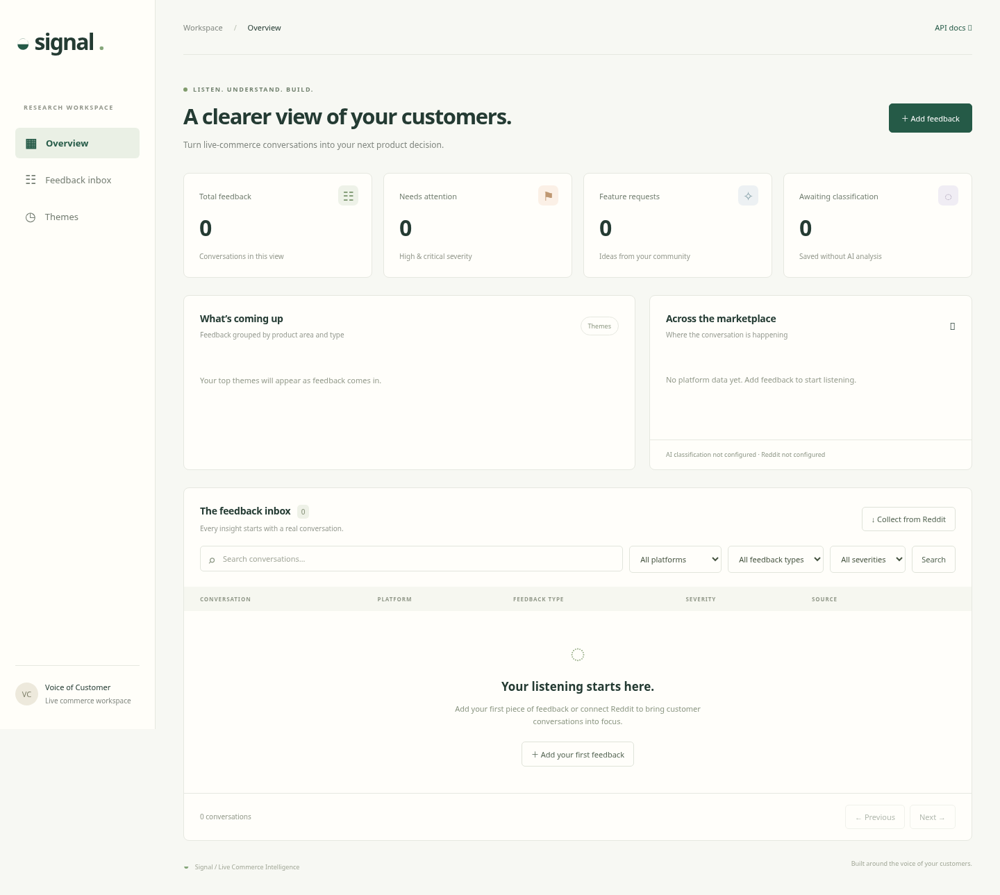

# Signal — Live Commerce Voice of Customer

A working first version of the uploaded live-commerce VOC project: a responsive dashboard backed by FastAPI, with SQLite locally and PostgreSQL for free hosting. Capture public customer feedback, keep its original evidence, search the inbox, and view counts by platform and feedback theme.

## Dashboard preview

This screenshot shows the implemented dashboard. It is a static preview; the interactive app runs using the instructions below.



## Open the interactive app online

[Deploy on Render](https://render.com/deploy?repo=https://github.com/kanhao-bytedance/bytedance) using the checked-in Blueprint. This selects Render’s free web service with password access. First create a free Neon PostgreSQL database, then enter its connection URL when Render prompts for `DATABASE_URL`. No paid disk or paid database is provisioned. Free-tier usage limits and idle wake-up delays apply. Follow the [deployment guide](docs/deployment.md) for setup, login, and live verification. No public instance has been provisioned from this workspace.

## Run on your computer

From this repository's root, with Python 3.12 or newer:

```bash
python -m venv .venv
source .venv/bin/activate
# Windows PowerShell: .venv\Scripts\Activate.ps1
python -m pip install -r requirements-dev.txt
python -m uvicorn app.main:app --reload
```

Open **http://127.0.0.1:8000** in your local browser for the dashboard, or `/docs` for the interactive API documentation. That address works on the computer running the command; it is not a public deployment address.

No credentials are needed to add and search feedback. SQLite creates `voc.db` locally on first startup. The UI starts empty and does not fabricate customer records or metrics.

## First workflow

1. Click **Add feedback**, enter a conversation, and save it.
2. Search by its words, or filter by platform, feedback type, and severity.
3. Click the conversation to read the original text, classification fields, and source link.
4. Watch the counts and themes update using the same filters as the inbox.

Feedback is deduplicated by `source` + `external_id`. Reusing a source reference returns the original record without overwriting it. Lists are paginated, newest ingestion first. Themes show aggregate counts, not changes over time or semantic clustering.

## Optional integrations

Copy `.env.example` to `.env` locally, or use your hosting service's secure environment configuration. Do not commit `.env` or credentials.

- `OPENAI_API_KEY`: enables AI classification of new feedback. `OPENAI_MODEL` selects a model available to your account that supports Responses API structured outputs. Without a key, records are explicitly marked **unclassified**, with relevance `0`; default categories and severity have not been evaluated. Adding a key does not reclassify existing records automatically.
- `REDDIT_BEARER_TOKEN`: an authorized Reddit OAuth bearer token. Set `REDDIT_USER_AGENT` to identify your application as required by Reddit. Use **Collect from Reddit** to search up to 100 posts per request. Expired tokens or denied access need to be corrected in your Reddit configuration.
- `DATABASE_URL`: defaults to `sqlite:///./voc.db`. For hosting, paste the PostgreSQL connection string from Neon into Render’s secure environment configuration. Standard `postgresql://` and `postgres://` URLs automatically use the installed psycopg driver; URL query parameters such as `sslmode=require` are preserved. Real credentials belong in secure configuration.

Required outbound destinations for enabled integrations are `api.openai.com` and `oauth.reddit.com`. The local manual workflow needs neither. Live integration access has not been verified; automated tests mock provider responses.

## API

| Method | Path | Behavior |
| --- | --- | --- |
| GET | `/health` | Database connection and integration configuration flags |
| POST | `/ingest` | Save and optionally classify a feedback record |
| POST | `/collect/reddit?q=…` | Collect authorized Reddit search results |
| GET | `/feedback` | Search, filter, and paginate records |
| GET | `/feedback/{id}` | Full original evidence and classification |
| GET | `/summary` | Counts and platform breakdown for the selected filters |
| GET | `/trends` | Product area × feedback type counts for the selected filters |

The list, summary, and trends endpoints share `q`, `platform`, `product_area`, `feedback_type`, `severity`, `sentiment`, `source`, and `classification_status` filters. The list also accepts `limit` (1–500) and `offset` (0 or greater).

Example ingestion:

```bash
curl -X POST http://127.0.0.1:8000/ingest \
  -H 'Content-Type: application/json' \
  -d '{"source":"manual","external_id":"demo-1","content_type":"comment","title":"Auction timer","text":"Please extend the timer after a last-second bid."}'
```

## Validation

```bash
python -m pytest -q
node --check app/static/app.js # Optional JavaScript syntax check, if Node is available
```

Tests use isolated in-memory databases and do not touch your feedback. They cover ingestion, deduplication, search, pagination, evidence retrieval, filtered metrics, classification schema, input validation, upstream failures, and static assets. A browser smoke check also exercised adding feedback, source details, safe text rendering, search, missing Reddit credentials, and mobile layout using a temporary database.

## Current scope and next steps

This MVP supports optional shared-workspace password access locally; the Render deployment requires it. Multi-user accounts, role-based permissions, and an audit log are not implemented. There are no scheduled collectors, comments/replies ingestion, historical comparison metrics, AI reclassification jobs, or schema migrations yet. Existing databases from the original ZIP need a migration before using the new `relevant` and `classification_status` columns; use a fresh development database or a separately planned migration, without deleting existing data.

Next milestones: authorized live integration validation, background collection with checkpoints, database migrations, time-series trends, and live hosting validation. Source adapters should use approved APIs or permitted exports.

The earlier repository initialization notes are preserved in [docs/repository-initialization.md](docs/repository-initialization.md).
